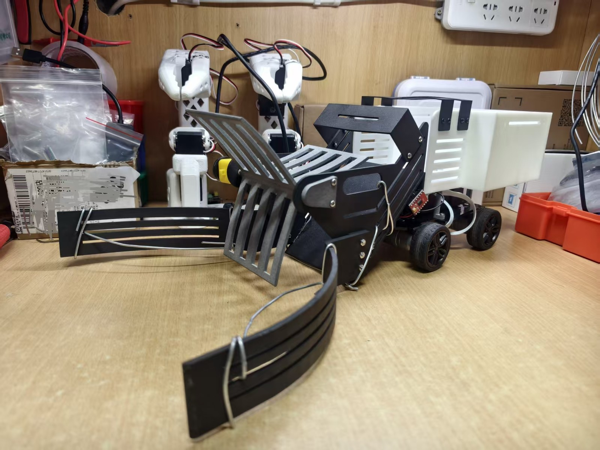

# PingPong Ball Collector

**English** · [简体中文](README.zh-CN.md)

> A reproducible, **remote-controlled** ping-pong ball collector built on a WHEELTEC R1 chassis purchased from Taobao and a C30D (STM32F407VET6) controller.

**Status:** `v0.2.0` · **remote-controlled** collector · 7-speed chassis & 7-level blade · custom Android console · camera-based autonomous version planned (YOLO / OpenCV)



---

## Version note: remote-controlled now, autonomous later

- **This release is remote-controlled.** A human drives the robot over Bluetooth; no vision or autonomy yet.
- **A camera-based automatic version is planned** using **YOLO or OpenCV** for ball detection, target selection, and self-alignment. It is still under development and will be published in this repository when ready.
- **Mechanical scope:** only the **chassis** (motors, wheels, base plate, from the WHEELTEC R1 chassis kit purchased on Taobao) is purchased. **All other mechanical structures** — three-blade intake, left/right guide claws, front shell, rear storage bin, and brackets — are **designed by the team**.
- **Controller:** the **C30D is also a WHEELTEC board** (STM32F407VET6); all vehicle firmware in this repository was developed on it.
- **Code provenance:** all firmware and app control code was **written by the team from scratch**, with **no secondary development based on vendor example projects**. The Android app is **entirely self-developed** — the open-sourced app is **not** the WHEELTEC Bluetooth app.

---

## What it is

Ping-pong training leaves balls scattered on the floor. This project collects them with a low-cost, buildable, extensible system:

- **WHEELTEC R1 4WD chassis purchased on Taobao** and **C30D (STM32F407VET6)** controller as the mature platform.
- Original **three-blade intake, left/right guide claws, rear storage bin, and mounting brackets**.
- Original **four-wheel differential control, encoder speed loop, blade-motor PWM, OLED status, and Bluetooth command layer**.
- A **fully self-developed** Android console (V3.2) is included; the open-sourced app is **not** the vendor app (the vendor app is only a compatibility reference).

> This is **not** a robot designed from scratch: the chassis and controller are purchased from WHEELTEC, but **all control firmware and the Android app were written by the team**, not derived from vendor example code. The contribution is a complete, reproducible, extensible system on top of a commercial platform.

---

## Development path

The cardboard model first validated the “gather → guide → store” geometry. Since cardboard cannot drive a continuously rotating, impact-loaded intake, the team moved to SolidWorks design and 3D printing, arriving at the three-blade rotor + guide claws + rear storage bin layout.

**Materials:** 9600 resin rear bin, 3201PA-F guide claws, PA12 nylon blades, 605ZZ bearing (5×11×5); M3 fasteners purchased in bulk (≈36 sets).

**Fastener allocation:** lid M3×10 ×2; blade motor mount M3×25 ×2; front top guard M3×7 ×4; arch cover M3×6 ×8; guide claws M3×12 ×6; other fixing points use M3×10 and are measured after assembly (see [hardware/assembly.md](hardware/assembly.md)).

**Design notes (needs improvement):** large front prints may warp or drift at the holes; our prototype did deform and interfered with the brackets, so the team used **local breakage + wire fixation** (the wire visible in the photo) as a temporary fix. The design still needs better support/print orientation, ribs or thicker walls, split printing for large parts, and assembly allowance.

Balls can also jam in the gap between the guide claws and the rotating blades. A **bent-wire baffle** on the claws is the current workaround; a future revision should **extend the straight section of the guide claws** to close that gap and make the inner surface more continuous with the blade sweep.

**Field photos:** [Fig. 1-1 local breakage + wire fixation](hardware/assembly.md), [Fig. 1-2 wire baffle on the guide claws](hardware/assembly.md) — see section 1.2 of the assembly guide.

**Cost (week-5 purchases):** ¥499.39 in total; 3D-printed parts ¥414.08 (82.9%), fasteners ¥44.60, electronics/TB6612 ¥14.80, zip ties ¥12.58, wire ¥10.87, bearing ¥2.46. Excludes the C30D board, chassis kit, and battery purchased earlier.

---

## What it is not

- **Not autonomous:** no vision, ROS, SLAM, or navigation. A human drives it over Bluetooth.
- **Chassis and controller are not from scratch:** the chassis means motors, wheels, and base plate (R1 chassis kit purchased on Taobao), and the controller is the C30D — both purchased from WHEELTEC. Everything above the chassis (intake, claws, shell, bin, brackets) is team-designed.
- **Not a product:** the structure is mainly 3D-printed and includes field fixes such as wire and zip ties. It is aimed at students, makers, and table-tennis enthusiasts.
- **No communication timeout yet:** if Bluetooth disconnects, the robot does not automatically stop. This is a known safety gap; see [Safety](#safety) and [Roadmap](#roadmap).

---

## Features

| Module | Implementation |
|---|---|
| Motion | 4-wheel skid steer, 8 directions; **7 chassis speeds** 400 ± 100 r/min |
| Speed loop | 200 Hz sampling, incremental PI (Kp=5.0, Ki=1.6), independent per wheel |
| Collector | 5 V DC motor + TB6612 driving a three-blade rotor; **7 levels, 70%–100% in 5% steps**, 100% at boot |
| HMI | OLED: target/actual RPM, speed level, blade duty, battery voltage |
| Communication | UART2 9600 8N1, Bluetooth SPP, ASCII single-byte commands |
| Host app | **Fully self-developed** Android console V3.2 (open-sourced here); vendor app only a compatibility reference |
| Safety | Chassis stops when the direction key is released; blade runs independently; battery monitoring |

---

## Architecture

```
Phone app --Bluetooth SPP--> JDY-33 module --UART2 9600--> C30D / STM32F407VET6
                                                             |
                          +----------------------------------+------------------+
                          |                                  |                  |
                   4x chassis motor drive            TIM8_CH1 / PC6          OLED / ADC
                   (on C30D)                          +-> TB6612 -> 5V blade  status
                          |
                   4x MG310P20 encoder motors
```

Mechanical path: guide claws gather balls → three-blade rotor pushes them → rear bin stores them.

---

## Repository layout

```
PingPong-Ball-Collector/
├── README.md（English）/ README.zh-CN.md（中文）
├── LICENSE / LICENSE-HARDWARE.md / LICENSE-DOCS.md
├── THIRD_PARTY_NOTICES.md
├── firmware/
│   ├── Fusion_OpenCar/       # complete Keil project (App/Hardware/Driver)
│   └── original/             # legacy single-file blade driver
├── app/                       # Android console V3.2 (src, res, signed APK)
├── hardware/
│   ├── cad/source/            # original SolidWorks parts
│   ├── cad/stl/               # printable STL
│   ├── drawings/              # assembly drawings
│   ├── BOM.csv
│   └── assembly.md
├── docs/                      # quick start, wiring, protocol, compatibility, vendor, troubleshooting
├── media/
└── .github/ISSUE_TEMPLATE/
```

---

## Hardware (summary)

Full list: [hardware/BOM.csv](hardware/BOM.csv).

**Purchased (WHEELTEC)**

- R1 4WD chassis kit purchased on Taobao (plates, wheels, fasteners; motors observed as 4× MG310P20 encoder gear motors)
- C30D V2.2 controller (STM32F407VET6)
- 12 V 2550 mAh Li-ion battery
- JDY-33-compatible Bluetooth SPP module
- 0.96" OLED (with the C30D kit)
- Official site: [www.wheeltec.net](https://www.wheeltec.net)

**Original / fabricated**

- 3D-printed: front housing, storage bin, three-blade rotor, left/right claws, blade shaft, front top guard, single/double brackets, arch cover, bearing cover, floor panel
- 605ZZ bearing (5×11×5)
- TB6612FNG driver board ×1 (+1 spare)
- 5 V DC gear motor (blade)
- M3 fasteners, steel wire, nylon zip ties

> Vendor models, prices, and availability are subject to WHEELTEC's pages. This repository does **not** include vendor CAD, schematics, manuals, or example projects.

---

## Quick start

1. **Platform:** buy the WHEELTEC R1 chassis on Taobao and a C30D V2.2; complete the vendor's basic assembly and factory test.
2. **Print:** use the STLs in [hardware/cad/stl](hardware/cad/stl). Suggested materials: storage bin 9600 resin, claws 3201PA-F, blade PA12 nylon.
3. **Assemble:** follow [hardware/assembly.md](hardware/assembly.md); check blade-to-housing clearance.
4. **Wire:** follow [docs/wiring.md](docs/wiring.md); test direction and stop with the wheels off the ground.
5. **Flash:** open `firmware/Fusion_OpenCar/Fusion_OpenCar.uvprojx` in Keil, build and download. See [firmware/README.md](firmware/README.md).
6. **Tune:** verify `A`–`H` with the vendor app, adjust blade duty with `T/U`, then run ball-collection tests.

> Always lift the wheels on first power-up. Keep hands away from the blade while it rotates.

---

## Communication protocol (summary)

Full details: [docs/communication.md](docs/communication.md).

| Command | ASCII | Function |
|---|---|---|
| `A` / `E` | 0x41 / 0x45 | Forward / backward |
| `B` / `D` | 0x42 / 0x44 | Forward-right arc / backward-right arc |
| `H` / `F` | 0x48 / 0x46 | Forward-left arc / backward-left arc |
| `C` / `G` | 0x43 / 0x47 | Spin right / spin left |
| `T` / `U` | 0x54 / 0x55 | Blade level +1 / −1 (7 levels, 5% each) |
| `X` / `Y` | 0x58 / 0x59 | Chassis level +1 / −1 (7 levels, 100 r/min each) |

Chassis: 7 levels 100–700 r/min (default 400). Blade: 7 levels 70%–100% in 5% steps (100% at boot). Status frames: `{A...}$`, `{B...}$`, `{C...}$`; optional `{D...}$` for gear/duty feedback.

---

## Original vs third-party

| Asset | Source | Handling |
|---|---|---|
| Mechanical parts (blade, claws, bin, brackets, housing) | Original | SLDPRT + STL, CERN-OHL-P-2.0 |
| `yellow_motor.h` | Original | MIT |
| Application logic (8-direction, PI, blade PWM, display) | Original / modified from vendor example | Logic documented; full project pending vendor confirmation |
| C30D example project, `CORE/`, `FWLIB/`, `SYSTEM/`, `WHEELTEC_BSP/` base code | WHEELTEC | **Not redistributed**; obtain from the vendor |
| R1 chassis (Taobao), C30D, motors, Bluetooth module | WHEELTEC | Referenced by model and official link only |
| Vendor CAD, schematics, manuals, app | WHEELTEC | **Not included** |
| Self-developed Android app | Original | Experimental; source to be cleaned and released |

> MIT / CERN-OHL-P-2.0 / CC BY 4.0 apply **only to original material explicitly marked as such**. Third-party hardware, software, and documentation remain subject to their owners' terms. This project is **not affiliated with or endorsed by** WHEELTEC.

---

## Safety

1. **No communication timeout (important):** the current firmware does not stop on Bluetooth disconnect; `dirkey` keeps the last command. Test in an open area with the robot in sight.
2. **Blade pinch hazard:** the 5 V blade motor can still pinch fingers or objects. Disconnect blade power while debugging.
3. **Chassis torque:** the 12 V 4WD chassis is strong. Lift the wheels for first tests.
4. **Battery:** use the vendor 12 V battery and charger; do not short, reverse, or charge unattended.
5. **Printed structure:** claws and brackets may crack after impacts. Inspect fasteners and cracks before each run.

---

## Roadmap

- [ ] Add assembly drawing PDF, STEP exports, demo GIF, and complete BOM pricing.
- [ ] Add a communication watchdog (e.g., zero all wheel targets after 500 ms without a valid command; optionally delay blade stop).
- [x] Release the self-developed Android app source (V3.2, `com.pxt.carcontrol`).
- [ ] Add reconnect and command validation to the app.
- [ ] Further modularize the standalone firmware application layer (`App/`) for reuse.
- [ ] Optional: heading hold, cruise speed, low-battery protection.
- [ ] **v0.4 camera-based autonomous version (planned / in development):** USB camera + YOLO / OpenCV ball detection → target selection → chassis alignment → automatic collection, reusing the existing chassis, blade mechanism, and firmware framework. Pending update.
- [ ] Not planned for now: ROS 2, SLAM, full autonomous navigation — first make fixed-scenario automatic collection reliable.

---

## License

- Original code (`firmware/Fusion_OpenCar/App`, `firmware/Fusion_OpenCar/Hardware`, `app/src`): **MIT** — [LICENSE](LICENSE).
- Original hardware (`hardware/cad/`): **CERN-OHL-P-2.0** — [LICENSE-HARDWARE.md](LICENSE-HARDWARE.md) / [full text](LICENSE-HARDWARE.txt).
- Documentation and images (`docs/`, `media/`, README): **CC BY 4.0** — [LICENSE-DOCS.md](LICENSE-DOCS.md) / [full text](LICENSE-DOCS.txt).
- STM32F4 **StdPeriph** under `firmware/Fusion_OpenCar/Driver/StdPeriph`: ST copyright, **SLA0044** — [LICENSE-ST.txt](firmware/Fusion_OpenCar/Driver/LICENSE-ST.txt).
- **CMSIS** under `firmware/Fusion_OpenCar/Driver/CMSIS`: ARM/ST copyright, **Apache-2.0** — [LICENSE-CMSIS.txt](firmware/Fusion_OpenCar/Driver/LICENSE-CMSIS.txt).
- Third-party assets: their owners' terms — [THIRD_PARTY_NOTICES.md](THIRD_PARTY_NOTICES.md).

---

## Acknowledgements

- WHEELTEC for the R1 chassis, C30D controller, example projects, and support channels.
- The Engineering Training Center and instructors for the project-based course.
- SolidWorks for mechanical design; JLC for 3D printing; Keil MDK and the STM32F4 standard peripheral library for firmware.

---

## Contact

- GitHub: [@pixutian](https://github.com/pixutian)
- Issues: [github.com/pixutian/PingPong-Ball-Collector/issues](https://github.com/pixutian/PingPong-Ball-Collector/issues)

> When reproducing, please open an issue with your chassis model, controller version, and collector design. Different R1/C30D batches may have interface differences.
