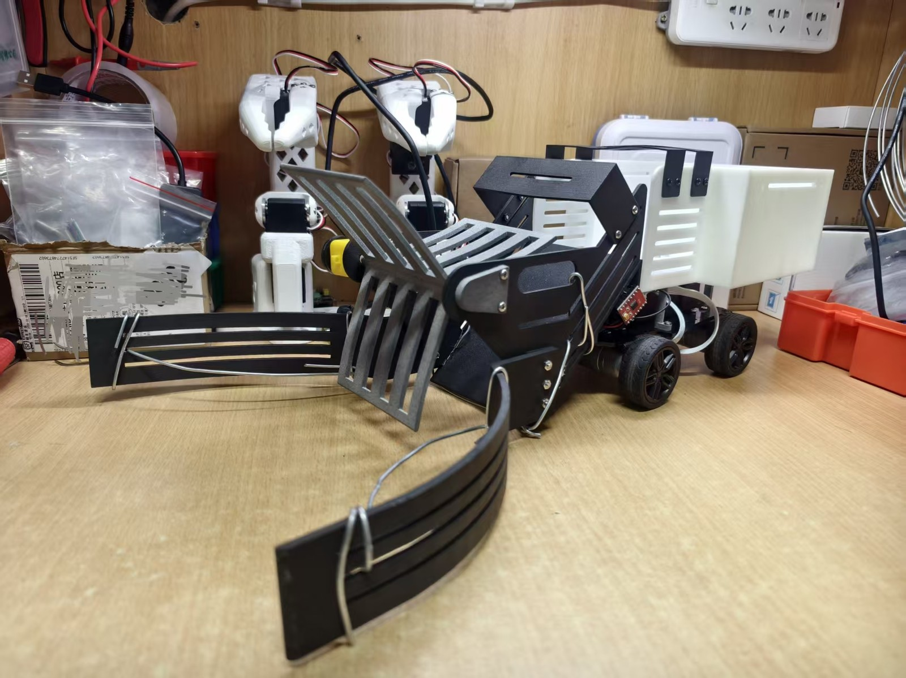

# PingPong Ball Collector · 乒乓球收集机器人

**简体中文** · [English](README.md)（英文版为摘要，细节以中文版为准）

> 基于商用四驱底盘与 C30D 主控板，自主设计收球机构、整车控制固件与 Android 蓝牙控制台的**遥控**乒乓球收集机器人。

**状态 / Status:** `v0.2.0` · 遥控收球 + 7 档车速 / 7 档叶片调速 + 自研 Android 控制台



---

## 版本说明：先遥控，后自动

**当前版本是遥控版**：操作者通过手机蓝牙遥控完成收集，重点是把机械结构、固件与上位机链路打通并稳定复现。

**后续将更新带摄像头的自动收集版本**（视觉方案为 **YOLO 或 OpenCV**），实现球体识别、目标选择与自主对准收集。自动版仍在开发中，完成后在本仓库更新；在此之前，本仓库的机械件、固件框架、蓝牙链路与安全策略都可以直接复用。

**机械结构范围**：**除底盘外，收球机构的机械结构均为团队自行设计**。这里说的“底盘”仅指**淘宝购置的轮趣 R1 小车底盘**（电机、车轮与车底板）；自行设计部分包括三叶片拨送机构、左右收拢爪、前壳体、后置储球箱及各级安装支架。

**主控板**：**C30D 同样是轮趣科技的主控板**（核心芯片 STM32F407VET6），本项目在其上完成整车固件开发。

**代码来源**：固件与 App 的**全部控制代码均为团队自行编写**，没有在厂家示例代码基础上做二次开发；蓝牙 App 为**纯自研**，本仓库开源的就是这支自研 App，**不是厂家的蓝牙 App**。

---

## 1. 项目简介

乒乓球训练场地上散落的球需要反复弯腰拾取。本项目在成熟的商用平台上完成一套**低成本、可制造、可复现、可扩展**的收球系统：

- 平台：**淘宝购置的轮趣科技 R1 四驱小车底盘** + **C30D（STM32F407VET6）** 驱控一体主控板；
- 机构：自主设计**三叶片拨送 + 左右收拢爪 + 后置储球箱 + 安装支架**；
- 固件：**Fusion_OpenCar** 完整 Keil 工程——200 Hz 四轮速度环、7 档车速、7 档叶片调速、OLED 状态、蓝牙指令与状态回传；
- 上位机：自研 Android **「收集车控制台」V3.2**（圆盘摇杆 + 加减档 + 停车 + 遥测）；本仓库开源的就是这支**纯自研** App，厂家 App 仅作兼容对照、不在仓库。

> 本项目不是“所有硬件从零设计”的机器人：底盘与主控板为轮趣科技采购件，但**控制固件与蓝牙 App 全部由团队自行编写，未在厂家示例代码上二次开发**。价值在于把成熟平台做成一套能实际工作、能复现、能继续扩展的完整系统。

---

### 1.1 设计目标

- **功能**：操作者远程控制前进、后退与转向；前端机构把地面散球导入储球箱；箱体便于集中倒出，减少反复俯身。
- **结构**：底盘具备带载能力；收集装置兼顾入口覆盖宽度、导流顺畅性、离地安全间隙与防卡球；整车适合低成本制造、检修与拆装，并预留二次开发孔位。
- **控制**：四驱差速、叶片电机启停与调速、手机蓝牙指令；OLED 显示转速、档位、叶片占空比与电池电压。
- **验证**：通过实体装配、SolidWorks 运动仿真、程序调试与现场演示综合验证；效率、续航、成本与可靠性需在统一定义的条件与重复试验下量化。

### 1.2 研发路径

先用纸板模型快速验证“收拢—导流—储存”的空间关系；确认纸板难以胜任连续旋转、承受冲击的主动收集件后，转入 SolidWorks 结构设计与 3D 打印，最终形成三叶片拨送 + 左右收拢爪 + 后置储球箱的整机方案。

### 1.3 机械设计（除底盘外均为自研）

- **收球路径**：左右弧形爪先把散球引向入口 → 三叶片旋转拨送 → 沿导流区域进入后箱储存。
- **材料选型**：后箱 9600 树脂；前端左右收拢爪 3201PA-F；旋转叶片 PA12 尼龙；自由端支承 605ZZ 深沟球轴承（5×11×5）。
- **紧固件**：M3×6/×7/×8/×9/×10/×12/×25/×30 与 M3 螺母，采购按整包、装配用量约 36 套；
  具体分配：盒盖 M3×10 ×2；叶片驱动电机处 M3×25 ×2；前挡顶 M3×7 ×4；拱顶 M3×6 ×8；夹爪 M3×12 ×6；
  其他固定处统一用 M3×10，装配后按实际孔位测量补配（见 [hardware/assembly.md](hardware/assembly.md)）。
- **主要自研件**：三叶片、左右收拢爪、前壳体、后置储球箱、前挡顶、单/双支架、拱顶、盒盖、叶片轴、地板。
- **前端打印件变形（待改进）**：前壳体、收拢爪等较大打印件在打印过程中可能出现翘曲或孔位偏移，本团队样机即出现变形并与支架干涉；现场采用**局部断开干涉处 + 铁丝绕孔固定**处理（实物图中的铁丝即为此用）。这是临时方案，设计仍需改进：优化支撑与打印方向、加厚或增加加强筋、大件分件打印、预留装配调整余量。
- **导流爪与叶片间隙卡球（待改进）**：球可能卡在导流爪与旋转叶片之间的空隙，影响连续收球；当前在左右导流爪上加装**弯折铁丝隔断**。后续改进可**延长导流爪的直杆段**，减小该处空隙，并让爪内侧与叶片扫掠面更连续。
- **其他现场处理**：自由端轴承未及时到货 → 拆空一侧电机盒作低阻力从动支承（临时方案，正式复现建议按设计装轴承与盒盖）。
- **现场照片**：[图1-1 前壳体局部打断 + 铁丝固定](hardware/assembly.md)、[图1-2 导流爪铁丝隔断](hardware/assembly.md)（见硬件装配文档 1.2 节）。
- **边界**：淘宝购置的轮趣 R1 小车底盘（电机、车轮、车底板）为采购件，不计入团队自研机械成果；上层收球机构与总装集成为自主设计。

### 1.4 电气与嵌入式

- **主控**：轮趣 C30D（STM32F407VET6），板载四路底盘驱动、OLED、ADC 与编码器接口；团队完成控制程序、外接驱动与整车集成。
- **底盘**：4× MG310P20 编码减速电机（标称 7.4 V），四轮差速。
- **叶片驱动**：5 V 直流电机 + TB6612FNG；C30D `PC6`（TIM8_CH1）→ `PWMA`，`3V3` → `STBY`，`5V` → `VM`，`AIN2` 接地定向，`AO1/AO2` 接电机。
- **固件**：USART2（9600）中断解析指令；TIM7 5 ms（200 Hz）执行四路增量式 PI（Kp=5.0，Ki=1.6）；编码器按 30×13×4 = 1560 计数/圈换算转速；主循环负责 OLED 与状态回传。
- **叶片 PWM**：TIM8 预分频 0、ARR=9999，约 16.8 kHz；当前 7 档占空比 70%–100%，每档 5%。
- **上位机**：本仓库开源的是自研 **V3.2** 控制台（纯自研，不是厂家 App）；厂家 App 仅作兼容对照。

### 1.5 成本（第五周补充采购与加工）

| 类别 | 金额 / 元 | 占比 |
|---|---|---|
| 3D 打印件（车前端、后备箱、叶片、左爪、拱顶、盒盖、支架、叶片轴等） | 414.08 | 82.9% |
| 紧固件（M3 机丝/螺母，整包） | 44.60 | 8.9% |
| 电控与驱动（TB6612 ×2 + 运费） | 14.80 | 3.0% |
| 尼龙扎带及运费 | 12.58 | 2.5% |
| 线材（镀锌铁丝） | 10.87 | 2.2% |
| 轴承 605ZZ | 2.46 | 0.5% |
| **合计** | **499.39** | 100% |

- 3D 打印是成本主体：车前端（120.64）与后备箱（127.01）两件大件合计 247.65 元，约占整机物料成本一半；叶片 70.60、左爪 55.17 也按体积计价。
- 紧固件均为 100–200 只整包采购，折算单只约 0.02–0.04 元，属一次采购、长期复用的低值件。
- 以上不含赛前采购的 C30D 主控板、四驱底盘套件与锂电池，也不含人工、设备折旧与重复打印试错件。

---

## 2. 它不是什么

- **当前不是自主机器人**：本版为遥控版，没有视觉识别、ROS、SLAM 或自主导航；带摄像头的自动版（YOLO/OpenCV）在后续版本更新。
- **底盘与主控不是从零设计**：底盘仅指电机、车轮、车底板（淘宝购置的轮趣 R1 小车底盘），主控为 C30D，均为轮趣科技采购件；**除底盘外的收球机构机械结构均为自行设计**。
- **不是量产产品**：结构以 3D 打印为主，装配中使用铁丝、扎带等临时修正。
- **仍缺通信超时停车**：蓝牙断开后底盘会保持最后一条方向指令，详见 [安全说明](#8-安全说明)。

---

## 3. 功能一览（v0.2）

| 模块 | 实现 |
|---|---|
| 移动 | 四轮差速，8 方向（前进/后退/四个斜向/原地左右转） |
| 车速 | **7 档循环**：400 ± 100 r/min（100/200/…/700），上电中间档 400 |
| 速度环 | 200 Hz 采样，四轮独立增量式 PI（Kp=5.0，Ki=1.6） |
| 收球机构 | 5 V 直流电机 + TB6612 驱动三叶片；**7 档占空比**：70%–100%，每档 5%，上电 100% |
| 人机界面 | OLED：目标/实际转速、档位、叶片占空比、电池电压 |
| 通信 | USART2 9600 8N1，经典蓝牙 SPP，单字节 ASCII 指令 |
| 状态回传 | `{A...}$` 轮速/电量/航向，`{B...}$` 姿态，`{C...}$` 调试参数（`{D...}$` 档位回传为可选补丁） |
| 上位机 | **纯自研** Android V3.2（本仓库开源方案）；厂家 App 仅兼容对照 |
| 安全 | 松手即停底盘；叶片独立保持；电池电压监测 |

---

## 4. 系统结构

```
手机 App（V3.2 / 厂家 App）
        │  经典蓝牙 SPP
        ▼
  JDY-33 / HC-02 兼容模块  ──UART2 9600──►  C30D（STM32F407VET6）
                                                │
                    ┌───────────────────────────┼──────────────────────────┐
                    │                           │                          │
             4× 底盘电机驱动              TIM8_CH1 / PC6                 OLED / ADC
             （C30D 板载）                 └─► TB6612 ─► 5V 叶片电机      状态显示
                    │
             4× MG310P20 编码电机
```

- **机械层**：前端左右爪收拢 → 三叶片拨送 → 后箱储存。
- **电气层**：12 V 电池；C30D 集成四路底盘驱动；外接 TB6612 驱动叶片电机。
- **嵌入式层**：USART2 中断解析指令；TIM7 5 ms 中断执行速度环；主循环处理显示与回传。
- **上位机层**：V3.2 下发方向/档位/叶片指令，并解析状态帧。

---

## 5. 仓库结构

```
PingPong-Ball-Collector-20261107/
├── README.md（English）/ README.zh-CN.md（中文）
├── CHANGELOG.md                  # 版本变更
├── LICENSE                       # 原创代码：MIT
├── LICENSE-HARDWARE.md/.txt      # 原创硬件设计：CERN-OHL-P-2.0（.txt 为全文）
├── LICENSE-DOCS.md/.txt          # 文档与图片：CC BY 4.0（.txt 为全文）
├── THIRD_PARTY_NOTICES.md        # 第三方组件与商标声明
├── firmware/
│   ├── README.md                 # 编译、烧录、参数说明
│   ├── Fusion_OpenCar/           # ★ 当前完整固件（Keil 工程）
│   │   ├── App/                  # 业务层：档位、PI、链路、主循环
│   │   ├── Hardware/             # 板级驱动：电机/编码器/IMU/OLED/串口
│   │   ├── Driver/               # ST CMSIS + StdPeriph（第三方，原样）
│   │   └── Fusion_OpenCar.uvprojx
│   └── original/
│       └── yellow_motor.h        # 早期叶片驱动（历史参考）
├── app/                          # ★ 自研 Android 控制台 V3.2
│   ├── README.md
│   ├── AndroidManifest.xml
│   ├── src/com/pxt/carcontrol/   # MainActivity / JoystickPad / GearBar / BtLink / Ui
│   ├── res/                      # 应用图标
│   └── CarControl-v3.2.apk       # 已签名安装包
├── hardware/                     # BOM、装配说明、CAD、STL、工程图
├── docs/
│   ├── quick-start.md            # 快速上手
│   ├── wiring.md                 # 电气接线
│   ├── communication.md          # 蓝牙协议（v0.2 已更新）
│   ├── compatibility.md          # 软硬件兼容性
│   ├── vendor-hardware.md        # 轮趣硬件依赖
│   └── troubleshooting.md        # 常见问题
├── media/                        # 实物、装配、接线、测试图片
└── .github/ISSUE_TEMPLATE/
```

---

## 6. 快速开始

1. **准备平台**：淘宝购置的轮趣 R1 小车底盘 + C30D V2.2，按厂家手册完成基础连接与出厂测试。
2. **打印与装配**：用 [hardware/cad/stl](hardware/cad/stl) 打印；材料建议见 [hardware/assembly.md](hardware/assembly.md)（后箱 9600 树脂、前爪 3201PA-F、叶片 PA12）。
3. **接线**：按 [docs/wiring.md](docs/wiring.md) 连接 TB6612、叶片电机、蓝牙模块与电源；先空载测试方向与急停。
4. **烧录固件**：用 Keil 打开 `firmware/Fusion_OpenCar/Fusion_OpenCar.uvprojx`，编译并下载；步骤见 [firmware/README.md](firmware/README.md)。
5. **安装 App**：手机安装 `app/CarControl-v3.2.apk`；先在系统蓝牙中配对模块（HC-02/JDY-33）。
6. **联调**：连接 → 按“停止” → 圆盘轻推验证八方向 → 试底盘/叶片加减档 → 实球收集。

> 首次上电务必架空车轮；叶片旋转时不要把手伸入前端机构。

---

## 7. 通信协议（摘要）

完整说明见 [docs/communication.md](docs/communication.md)。

| 指令 | ASCII | 功能 |
|---|---|---|
| `A` / `E` | 0x41 / 0x45 | 前进 / 后退 |
| `B` / `D` | 0x42 / 0x44 | 右前弧线 / 右后弧线 |
| `H` / `F` | 0x48 / 0x46 | 左前弧线 / 左后弧线 |
| `C` / `G` | 0x43 / 0x47 | 原地右转 / 原地左转 |
| `X` / `Y` | 0x58 / 0x59 | 底盘升档 / 降档（7 档循环） |
| `T` / `U` | 0x54 / 0x55 | 叶片升档 / 降档（7 档循环） |
| `S` | 0x53 | 停止（四轮目标清零） |

- 底盘 7 档：`400 + (gear - 3) × 100` r/min；越界回中间档 3。
- 叶片 7 档：`100 − (6 − gear) × 5` %，即 70%–100%；上电 100%，越界回中间档 85%。
- `X/Y/T/U` 在固件侧有 200 ms 去抖；APP 需按 ≥250 ms 间隔发送，否则会“APP 加一档、车端没加”。

---

## 8. 安全说明

1. **没有通信超时停机（重要）**：蓝牙断开后 `g_link_dir` 保持最后指令，底盘会继续运动。请在开阔场地测试，并保持手机与机器人可见；修复建议见 [Roadmap](#9-roadmap)。
2. **叶片夹伤**：叶片由 5 V 电机驱动，仍可能夹住手指或异物；调试时先断开叶片电源。
3. **底盘力量**：12 V 四驱扭矩较大；首次测试架空车轮，确认方向与急停后再落地。
4. **电池**：使用厂家配套 12 V 锂电池与充电器；不要短路、反接或无人看管充电。
5. **结构强度**：3D 打印件（前爪、支架）撞击后可能断裂；演示前检查紧固件与裂纹。

---

## 9. Roadmap

- [x] **v0.2**：完整固件工程入库；7 档车速 + 7 档叶片调速；自研 App V3.2（圆盘摇杆、加减档、遥测、日志）。
- [ ] **v0.2.x**：加入通信超时停机（500 ms 未收到有效方向指令则四轮目标清零，叶片可延时停止）。
- [ ] **v0.2.x**：固件增加 `{D<叶片占空比>:<底盘档位>}$` 回传（补丁见 `firmware/README.md`），APP 已支持解析。
- [ ] **v0.3**：APP 断线自动重连；固件增加叶片测速（霍尔/编码器）后显示实际转速。
- [ ] **v0.3**（可选）：叶片档位改 13 档、保持 40%–100% 全范围（每档 5%）。
- [ ] **v0.4 视觉自动版（规划/开发中）**：USB 摄像头 + YOLO / OpenCV 球体检测 → 目标选择 → 底盘对准 → 自动收集；复用现有底盘、叶片机构与固件框架，等待更新。
- [ ] **暂不做**：ROS 2、SLAM、全自主导航——先把“看得见、对得准、收得进”的固定场景自动收集做扎实。

---

## 10. 原创与第三方边界

| 资产 | 来源 | 本仓库处理 |
|---|---|---|
| 三叶片、收拢爪、储球箱、支架、前壳体等机械件 | 本项目原创 | SLDPRT + STL，CERN-OHL-P-2.0 |
| `App/`、`Hardware/` 中的应用逻辑与板级驱动 | 本项目**独立编写**（未在厂家示例上二次开发） | MIT（第三方部分除外） |
| `Driver/CMSIS`、`Driver/StdPeriph` | STMicroelectronics | 原样保留，按 ST 许可使用 |
| 厂家示例工程、BSP 基线、C30D 资料 | 轮趣科技 | **未使用、不分发**；版权归厂家 |
| 淘宝购置的轮趣 R1 小车底盘（电机、车轮、车底板） | 轮趣科技 | 采购件，仅以型号与官方链接说明 |
| C30D 主控板 | 轮趣科技 | 采购件，仅以型号与官方链接说明 |
| 蓝牙模块、TB6612、OLED 等通用器件 | 各器件厂商 | 通用采购件，按原厂资料使用 |
| 自研 Android App（非厂家 App） | 本项目原创 | MIT；源码与 APK 一并提供 |

> 仓库中的 MIT / CERN-OHL-P-2.0 / CC BY 4.0 **只覆盖明确标注为原创的部分**。第三方硬件、软件、文档仍受其各自权利人条款约束。本项目与轮趣科技**没有官方隶属或背书关系**。
>
> 许可全文：`LICENSE`（MIT）、`LICENSE-HARDWARE.txt`（CERN-OHL-P-2.0）、`LICENSE-DOCS.txt`（CC BY 4.0）；
> `firmware/Fusion_OpenCar/Driver/StdPeriph` 为 ST 标准外设库，按 SLA0044 授权（`Driver/LICENSE-ST.txt`）；
> `Driver/CMSIS` 为 CMSIS 文件，按 Apache-2.0 授权（`Driver/LICENSE-CMSIS.txt`）。

---

## 11. 文档索引

| 文档 | 内容 |
|---|---|
| [docs/quick-start.md](docs/quick-start.md) | 从零到第一次遥控 |
| [docs/wiring.md](docs/wiring.md) | 接线与上电检查 |
| [docs/communication.md](docs/communication.md) | 指令、档位、回传帧 |
| [docs/compatibility.md](docs/compatibility.md) | 已验证/未验证组合 |
| [docs/troubleshooting.md](docs/troubleshooting.md) | 常见故障 |
| [firmware/README.md](firmware/README.md) | Keil 编译、烧录、参数 |
| [app/README.md](app/README.md) | APP 功能、协议映射、编译 |
| [CHANGELOG.md](CHANGELOG.md) | 版本记录 |
