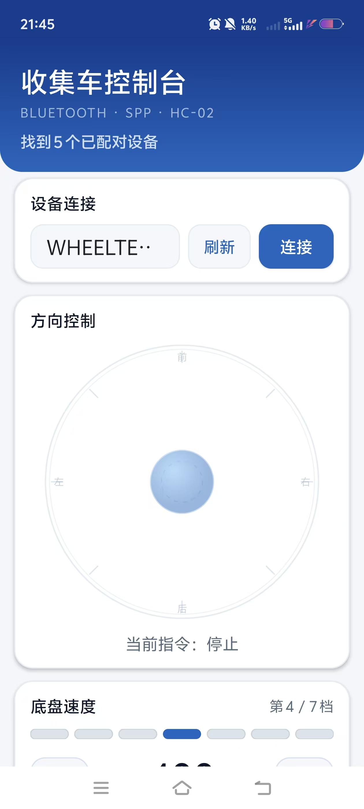
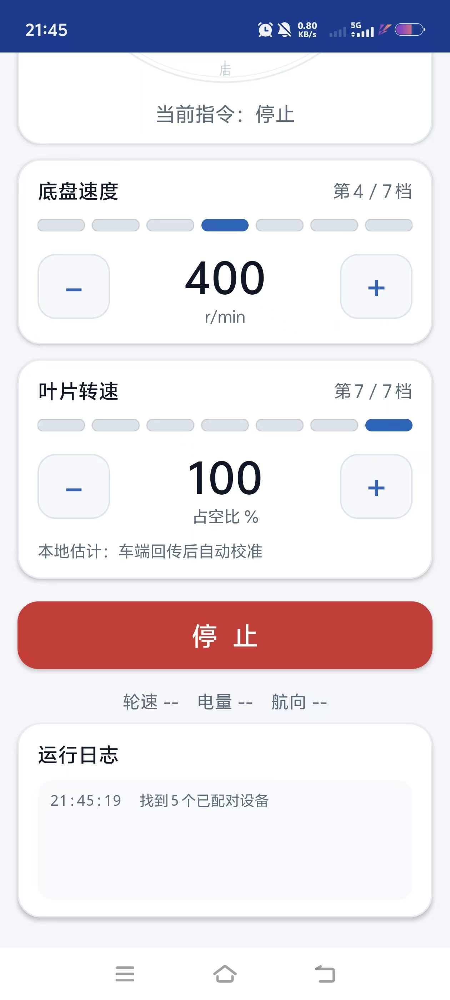

# App · 收集车控制台 V3.2（Android）

> 自研蓝牙遥控上位机，与 `firmware/Fusion_OpenCar` 的单字节协议逐条对齐。
>
> **本 App 为纯自研**，本仓库开源的就是这支自研 App，**不是厂家蓝牙 App**；厂家 App 仅作兼容对照，不在仓库内。
> 安装包：[`CarControl-v3.2.apk`](CarControl-v3.2.apk)，源码：[`src/`](src/)。

---

## 1. 基本信息

| 项目 | 内容 |
|---|---|
| 应用名 | 收集车控制台 |
| 包名 | `com.pxt.carcontrol` |
| 版本 | 3.2（versionCode 5） |
| 安装包 | 约 57 KB，已签名（测试密钥，见第 7 节） |
| 系统 | Android 6.0+（minSdk 23），targetSdk / compileSdk 34 |
| 通信 | 经典蓝牙 SPP（RFCOMM），UUID `00001101-0000-1000-8000-00805F9B34FB` |
| 权限 | `BLUETOOTH_CONNECT`（Android 12+ 运行时）、`BLUETOOTH` / `BLUETOOTH_ADMIN`（≤API 30） |
| 特性 | `android.hardware.bluetooth` 必需 |
| 组件 | 单 `MainActivity` + 自定义 `JoystickPad`、`GearBar` |

---

## 1.1 界面截图





## 2. 界面

整体蓝白灰配色：深蓝渐变标题区、白色圆角卡片、灰色辅助文字、蓝色强调。

1. **设备连接**：已配对设备下拉、刷新、连接/断开（自动选中名称含 HC / JDY / BT 的设备）
2. **方向控制**：圆形方向盘，8 个 45° 扇区，16% 死区，扇区淡蓝高亮，**松手立即停止**
3. **底盘速度**：7 点档位条 + 大号目标转速 + 加减键（可按住连发）
4. **叶片转速**：7 点档位条 + 大号占空比 + 加减键
5. **停止**：红色大按钮
6. **状态**：轮速 A/B、电量、航向；底部运行日志

---

## 3. 与固件的对应关系

| APP 操作 | 发送 | 固件行为 |
|---|---|---|
| 圆盘 8 方向 | `A`–`H` | `g_link_dir = recv − 0x40` → 1–8 |
| 松手 / 停止 | `S` | 0x13 → `default`，四轮目标清零 |
| 底盘 ＋/－ | `X` / `Y` | `chassis_gear_change(±1)`：7 档循环，`400 + (g−3)×100` r/min |
| 叶片 ＋/－ | `T` / `U` | `aux_gear_change(±1)`：7 档循环，`100 − (6−g)×5` % |

**叶片档位表**

| APP 显示 | gear | 占空比 |
|---|---|---|
| 第 1 / 7 档 | 0 | 70% |
| 第 2 / 7 档 | 1 | 75% |
| 第 3 / 7 档 | 2 | 80% |
| 第 4 / 7 档 | 3 | 85%（中间档） |
| 第 5 / 7 档 | 4 | 90% |
| 第 6 / 7 档 | 5 | 95% |
| 第 7 / 7 档 | 6 | 100%（上电默认） |

> 固件对 `X/Y/T/U` 有 **200 ms** 去抖。APP 用 **260 ms 指令队列**发送，并只在发送成功后才更新显示，
> 避免“APP 加一档、车端没加”造成的显示错位。

---

## 4. 状态回传

APP 按 `$` 切帧，支持：

| 帧 | 内容 | 用途 |
|---|---|---|
| `{A<rpmA>:<rpmB>:<电量>:<航向>}$` | 轮速、电量、航向 | 底部状态条 |
| `{B<pitch>:<roll>:<yaw>}$` | 姿态 | 日志 |
| `{C<p1>:<p2>}$` | 调试参数 | 日志 |
| `{D<叶片占空比>:<底盘档位>}$` | 档位/占空比 | 与车端对齐（**可选**，需固件补丁） |

未收到 `{D}` 时，界面显示“本地估计”；收到后变绿显示“已与车端同步”。
固件补丁见 [../firmware/README.md](../firmware/README.md) 第 5.1 节。

---

## 5. 安装

1. 手机与 HC-02 / JDY-33 在系统蓝牙中配对（APP 只读已配对设备，不扫描）。
2. 安装 `CarControl-v3.2.apk`（允许“未知来源”）。
3. 打开 → 授予蓝牙权限 → 刷新 → 选择设备 → 连接。
4. 圆盘拖动控制方向，松手停车；加减键调底盘/叶片档位。

---

## 6. 编译

需要 JDK 17+、Android SDK（platform 34、build-tools 35.0.0 及以上）：

```bash
SDK=/path/to/android-sdk
BT=$SDK/build-tools/35.0.0
JAR=$SDK/platforms/android-34/android.jar

mkdir -p build/obj build/dex
javac -source 8 -target 8 -bootclasspath $JAR -d build/obj $(find src -name "*.java")
$BT/d8 --release --min-api 23 --lib $JAR --output build/dex $(find build/obj -name "*.class")
$BT/aapt2 compile --dir res -o build/res.zip
$BT/aapt2 link -o build/app-unsigned.apk -I $JAR --manifest AndroidManifest.xml \
    -R build/res.zip --min-sdk-version 23 --target-sdk-version 34 \
    --version-code 5 --version-name 3.2
cd build && cp app-unsigned.apk app.apk && zip -j app.apk dex/classes.dex
$BT/zipalign -f -p 4 app.apk app-aligned.apk
$BT/apksigner sign --ks /path/to/your.keystore \
    --ks-pass 'pass:******' --key-pass 'pass:******' \
    --out CarControl-v3.2.apk app-aligned.apk
```

> 注意：build-tools 34 的 `d8` 在 JDK 21 下会报 `NullPointerException`，请用 35.0.0 及以上。
> 也可用 `app/build.sh`（把 `SDK` 指到本机路径）。

---

## 7. 签名说明

仓库**不包含签名私钥**。发布的 APK 使用开发期测试密钥签名；正式分发或上架前，请：

1. 用 `keytool` 生成自己的 keystore；
2. 用同一密钥重签 APK；
3. 若手机已安装旧签名的版本，需先卸载再安装。

---

## 8. 已知限制

- 只支持已配对设备，不扫描周边（规避 Android 12+ 扫描/定位权限）。
- 无断线自动重连；蓝牙意外断开需手动重连。
- 叶片只有占空比指令，没有转速反馈；界面显示的是占空比，不是实测 RPM。
- 档位为本地镜像；若主控断电复位，按一次加/减即可对齐（或使用 `{D}` 回传自动对齐）。
