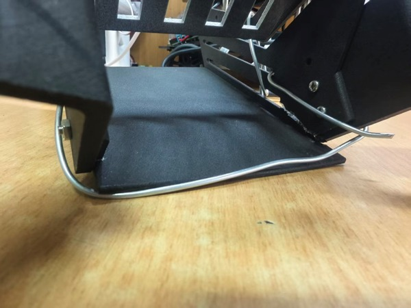
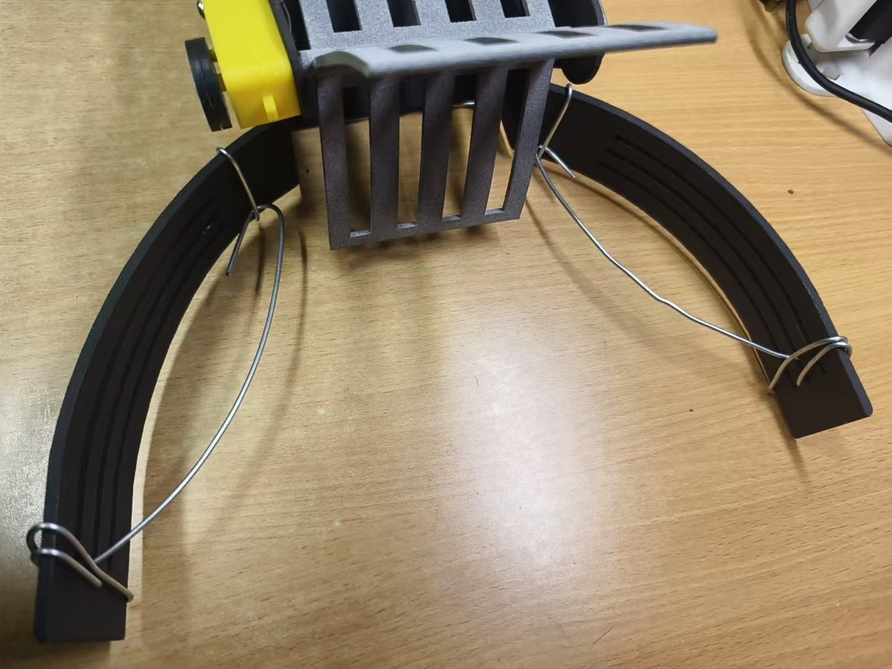

# Assembly Guide · 机械装配说明

> 目标：把原创收球机构装到淘宝购置的轮趣 R1 小车底盘上，并保证叶片转动顺畅、球能从前端进入后箱。
>
> 预计装配时间：2–4 小时（不含 3D 打印）。首次装配建议两人配合。

---

## 1. 准备

### 工具

- 内六角扳手 / 十字螺丝刀（M3）
- 尖嘴钳、斜口钳
- 3.2 mm 钻头（修整打印孔）
- 游标卡尺
- 美纹纸/记号笔
- 万用表（接线检查）
- 扎带、铁丝、螺纹胶

### 零件

| 类别 | 内容 |
|---|---|
| 采购平台 | 淘宝购置的轮趣 R1 小车底盘（轮组、底盘板；实车电机 4× MG310P20）、C30D V2.2、12 V 电池 |
| 打印件 | 前壳体、后箱、三叶片、左右爪、叶片轴、前挡顶、单/双支架、拱顶、盒盖、地板 |
| 传动 | 605ZZ 轴承、5 V 叶片电机、联轴器/轴接件 |
| 电气 | TB6612FNG、蓝牙模块、OLED、线束 |
| 紧固 | M3×6/7/8/9/10/12/25/30 螺钉、M3 螺母、垫片 |
| 辅材 | 铁丝、尼龙扎带、螺纹胶 |

### 1.1 紧固件装配对照

| 装配位置 | 螺钉规格 | 数量 | 说明 |
|---|---|---|---|
| 盒盖（轴承定位） | M3×10 | 2 | 先压入 605ZZ，再装盒盖，不要压死轴承 |
| 叶片驱动电机处 | M3×25 | 2 | 长螺钉，注意不要顶到电机内部 |
| 前挡顶 | M3×7 | 4 | 横向连接左右结构 |
| 拱顶 | M3×6 | 8 | 弧形限位/连接件 |
| 左右夹爪 | M3×12 | 6 | 每侧 3 颗，先预紧再对中 |
| 其他固定处 | M3×10 | 按需 | 装配后按实际孔位测量补配 |

- 以上为装配用量；采购按 100–200 只整包，剩余作为备件。
- M3 螺母与螺钉数量对应；关键受力处可加平垫/弹垫并点螺纹胶。
- 打印件孔位可能有 ±0.2–0.5 mm 偏差，先用手拧入，避免滑牙或开裂。

### 1.2 已知结构风险与处理

**（1）前端打印件变形**

- 现象：前壳体、收拢爪等较大打印件在打印过程中可能翘曲，或孔位与支架/侧板偏移，装配时产生干涉。
- 本团队样机即出现该情况，现场采用**局部断开干涉处 + 铁丝绕孔固定**（实物照片中车头的铁丝即为此用）。
- 该做法属于临时修正；后续设计建议：优化支撑与打印方向、加厚或增加加强筋、大件分件打印、孔位预留 0.3–0.5 mm 装配余量，装配前先试装修整。

*图 1-1　前壳体打印件局部打断后，用铁丝穿过孔位绕紧固定（样机实物）*

**（2）导流爪与旋转叶片之间卡球**

- 现象：球可能卡在导流爪与叶片扫掠面之间的空隙，影响连续收球。
- 当前处理：在左右导流爪上加装**弯折铁丝隔断**，阻断容易卡球的局部空隙。
- 后续改进：**延长导流爪的直杆段**，减小爪与叶片之间的间隙；同时让爪内侧与导流面更连续，必要时加柔性挡片。

*图 1-2　左右导流爪端部加装弯折铁丝隔断，阻断容易卡球的局部空隙*

> 打印件到货后先**不要急着装**：逐个对照 SolidWorks 模型检查变形、孔位和毛刺。
> 3D 打印件常见 ±0.2–0.5 mm 偏差，必要时先修整。

---

## 2. 装配步骤

### 步骤 1：底盘准备

1. 按 WHEELTEC R1 手册完成小车底盘、电机、轮组和电池的组装。
2. 确认四轮转向正确、电机线/编码器线对应 C30D 的 M1–M4 / E1–E4 接口。
3. 先不装上壳体，架空车轮测试前进/后退/转向。

### 步骤 2：安装前壳体

1. 将 `front-housing` 放到车底盘前端，对齐安装孔。
2. 用 M3×8/10 螺钉预紧，检查前壳体与地面平行、左右对称。
3. 如果孔位错位，用 3.2 mm 钻头轻微修整；不要强行拧入，避免打印件开裂。

### 步骤 3：安装叶片轴与自由端轴承

1. 将 605ZZ 轴承压入 `bearing-cover` 或前壳体轴承座（按实际配合）。
2. 将 `blade-shaft` 穿过轴承，确认转动顺畅、无明显轴向窜动。
3. 若轴承过松，可用少量厌氧胶/热熔固定；过紧则轻磨轴承座。
4. 安装 `bearing-cover`，注意不要压死轴承。

> 比赛样机因盒盖/轴承未及时到货，拆除了右侧电机盒内的电机，把该侧作为自由端支承。
> 这是临时方案；正式复现建议按设计安装轴承与盒盖。

### 步骤 4：安装叶片

1. 将三叶片装到叶片轴上，确认叶片方向：旋转时把球从入口推向后方。
2. 检查叶片与前端壳体、左右爪、底板的间隙；建议径向 ≥ 3 mm，轴向 ≥ 2 mm。
3. 手动旋转一周，确认无刮擦、无卡滞。
4. 用 M3 螺钉/紧定件固定叶片；必要时加螺纹胶。

### 步骤 5：安装左右收拢爪

1. 先装左爪，再装右爪；弧形开口朝前，形成“外宽内窄”的导流入口。
2. 用 M3×8/10 螺钉固定；如果下端与支架干涉，参考“已知问题”处理。
3. 检查爪底与地面的间隙：太小会刮地，太大会漏球；建议 5–10 mm，按场地调整。
4. 左右爪应对称，入口宽度略大于球直径（40 mm）。

### 步骤 6：安装前挡顶与拱顶

1. 将 `front-top-guard` 横向安装在前端，连接左右结构。
2. 将 `arch-cover` 安装在需要弧形限位/连接的位置（比赛样机未全部装车）。
3. 检查是否与叶片旋转包络干涉；必要时加垫片调整高度。

### 步骤 7：安装后箱与支架

1. 用 `single-bracket`（2 件）抬高后箱，使后箱入口与前端拨送通道对齐。
2. 用 `double-bracket` 做双侧连接，保持后箱与底盘的相对位置。
3. 先预紧所有螺钉，确认后箱入口低于叶片出口、球能顺利落入。
4. 检查后箱是否与车轮/电机干涉；必要时调整支架高度。

### 步骤 8：安装电控

1. 将 C30D 固定在底盘预留位置，OLED 朝上便于观察。
2. 将 TB6612 放在前部干燥位置，避免线与叶片接触。
3. 按 [docs/wiring.md](../docs/wiring.md) 接线：
   - C30D → TB6612：PC6→PWMA，3V3→STBY，3V3→AIN1，GND→AIN2，5V→VM；
   - TB6612 AO1/AO2 → 5 V 叶片电机；
   - 蓝牙模块 → UART2（PD5/PD6），9600；
   - 电池 → C30D 电源输入。
4. 所有电源共地；先用万用表确认 5V 与 12V 没有反接/短路。
5. 线束用扎带固定，远离叶片和车轮。

### 步骤 9：间隙与功能检查

| 检查项 | 合格标准 |
|---|---|
| 叶片旋转 | 手动一周无刮擦、无卡滞 |
| 叶片-壳体间隙 | 径向 ≥ 3 mm，轴向 ≥ 2 mm |
| 左右爪-地面 | 5–10 mm，不刮地 |
| 后箱入口 | 与叶片出口对齐，球能落入 |
| 轴承 | 转动顺畅，无轴向窜动 |
| 紧固件 | 全部拧紧，关键处加螺纹胶 |
| 线束 | 不进入运动包络，插头锁紧 |
| 电源 | 5V/12V/地无短路 |

### 步骤 10：上电测试

1. **架空车轮**，先只给 C30D 上电，确认 OLED 显示正常。
2. 用自研 App（也可用厂家 App 对照）连接，发送 `A`/`E` 确认前进/后退方向。
3. 发送 `C`/`G` 确认原地转向；如果方向相反，调整电机线或代码中的符号。
4. 发送 `T` 让叶片低速旋转，确认转向和噪音正常；再逐步加到 80%。
5. 落地，用少量乒乓球测试；从低速开始，观察是否卡球/漏球。
6. 确认无误后再进行完整收集测试。

---

## 3. 已知问题与现场修正

### 3.1 打印件变形/错位

比赛样机的左右爪下端与支架发生干涉，导致叶片碰撞。现场处理：

- 断开受干涉的下端连接处；
- 用铁丝绕孔固定，恢复叶片旋转空间；
- 重新检查叶片与爪的间隙。

**复现建议**：打印前在 SolidWorks 做干涉检查；把爪下端改为长圆孔/可调结构；
必要时用尼龙材料而不是脆性树脂。

### 3.2 轴承/盒盖未到货

比赛样机拆除了右侧电机盒内的电机，把该侧作为自由端支承。**这不是推荐方案**：
- 失去一侧驱动，转向和爬坡能力下降；
- 轴系同轴度依赖打印件，长期磨损大。

**复现建议**：按设计安装 605ZZ 轴承 + 盒盖；如果必须临时处理，限制运行时间并定期检查。

### 3.3 卡球

第三代样机初期出现卡球：球被叶片推到导流夹边缘后停住。现场在左右导流爪上加装**弯折铁丝隔断**，阻断容易卡球的局部空隙（见 1.2）。
**复现与改进建议**：
- **延长导流爪的直杆段**，减小爪与叶片之间的空隙；
- 加大入口到叶片的过渡圆角；
- 检查左右爪与叶片之间的“死区”；
- 叶片转速不要过低（建议 60–80%）；
- 用不同品牌/新旧程度的球测试（直径和摩擦差异）。

### 3.4 前爪断裂

前爪材料为 3201PA-F，抗冲击但打印层间强度有限。撞击后可能从层纹处断裂。
**复现建议**：增加壁厚/填充，或改用 PA12/尼龙；把易撞部位做成可更换件。

---

## 4. 维护

- 每次使用前检查叶片、爪、支架是否有裂纹；紧固件是否松动。
- 清理后箱内的灰尘/毛发，避免卡住球。
- 轴承定期加少量润滑脂；避免水洗。
- 长期存放时取出电池，放在干燥处。
- 如果更换电机/编码器，重新确认转向与编码器符号。

---

## 5. 参考图片

- 整车装配：`../media/assembly.png`
- 爆炸图：`../media/exploded-view.png`
- 装配工程图：`../media/assembly-drawing.png`
- 实物接线：`../media/wiring-photo.png`
- 打印件问题：`../media/issue-deformation.jpg`、`../media/issue-jam.jpg`

> 图片来自项目报告，已去除个人信息；仅用于说明装配关系。
